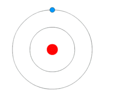

# Md. Shahnewaj Al Hasan

**Computational Nuclear Physics · Nuclear Data Evaluation**

B.Sc. Physics (Final Year) · University of Chittagong, Bangladesh

---

## About

I work on **neutron-induced nuclear reactions**, using statistical-model calculations to
understand how model assumptions propagate into predicted cross sections. My current focus is
the role of **nuclear level-density models** in the 56Fe(n,p)56Mn reaction,
and how reliably such predictions hold up when validated against experimental data from the
**EXFOR** library under different holdout schemes.

I am applying for **M.Sc. / research positions in theoretical and computational nuclear physics**
for the upcoming admission cycle.

---

## Research

### Manuscripts under review

- **Theoretical Evaluation of Level-Density Effects in Neutron-Induced Fe(n,p)Mn Reactions**
  *Under review, 2026.* [Draft](https://drive.google.com/file/d/14eB0ykDVxnagzTNe87E1Eqi6EVgb4SOh/view?usp=drive_link)

- **Reaction-Conditioned Reliability Assessment of 56Fe Neutron Cross-Section Predictions
  under Operational Experiment-Group, Publication and Chronological EXFOR Holdouts**
  *Under review, 2026.* [Draft](https://drive.google.com/file/d/1yNxj9JG0BFiPRa2nWAPXJMm3x_P5mGfw/view?usp=drive_link)

### Interests

- Statistical (Hauser–Feshbach) nuclear reaction theory
- Nuclear level-density models and their systematic uncertainties
- Nuclear data evaluation and validation against experimental libraries
- Reproducible, data-driven workflows for reaction-model benchmarking

---

## Research code

| Repository | What it does |
|---|---|
| [`exfor-retrieval`](https://github.com/shahnewaj12008044/Nuclear-Data-Scrapping-and-Evaluation/tree/main/notebooks/scrapers) | Retrieves and parses experimental cross-section data from the EXFOR library into tidy, analysis-ready tables |
| [`talys-cross-section-plots`](https://github.com/shahnewaj12008044/Nuclear-Data-Scrapping-and-Evaluation/tree/main/notebooks) | Parses TALYS output and plots calculated excitation functions against experimental data |
| [`level-density-comparison`](https://github.com/shahnewaj12008044/Nuclear-Data-Scrapping-and-Evaluation/tree/main/notebooks/fe-56) | Runs TALYS across level-density model options and compares the resulting cross-section predictions |

All three live in [`Nuclear-Data-Scrapping-and-Evaluation`](https://github.com/shahnewaj12008044/Nuclear-Data-Scrapping-and-Evaluation) — TALYS 2.2 + EXFOR notebooks for Fe/Cr isotopes.

---

## Toolkit

**Nuclear physics**

statistical reaction modelling · cross-section evaluation

**Scientific computing**

**Software engineering**

I build production web applications as well as research code. For computational physics this is
an asset rather than a detour: it means I can write maintainable, tested, reproducible analysis
pipelines rather than one-off scripts.

---

## Education

**B.Sc. (Honours) in Physics** — University of Chittagong
CGPA 3.52 / 4.00 (through third year)

**IELTS Academic** — Overall 7.0 (L 7.5 · R 7.0 · S 6.5 · W 6.0)

---

## Beyond research

- **Founding Member**, University of Chittagong Physics Club — connecting alumni with students
  pursuing higher study abroad, and organising mentoring seminars
- **Assistant General Secretary**, Ek Takay Shikkha — student volunteer organisation funding
  education for underprivileged children
- **Bronze Medal**, University Physics Competition, 2025

---

